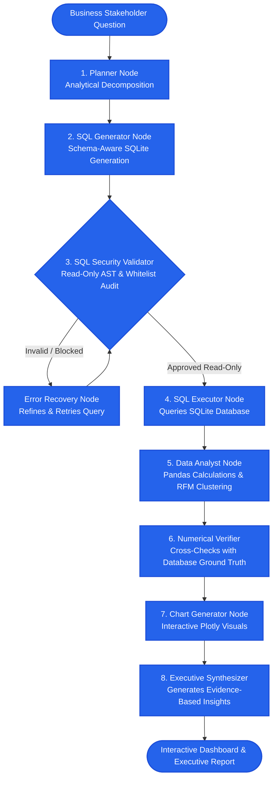

# ⚡ AgentAnalyst: Enterprise Agentic AI Data Analyst

[](https://www.python.org/)
[](https://github.com/langchain-ai/langgraph)
[](https://fastapi.tiangolo.com/)
[](https://streamlit.io/)
[](https://plotly.com/)
[]()

> An autonomous, evidence-based AI Data Analyst powered by **LangGraph**, **SQL**, **Pandas**, **Scikit-Learn**, and **Plotly**. Answers complex business questions by querying relational databases, executing Python statistical calculations, auditing arithmetic against ground-truth database records, and rendering interactive executive reports and visualizations.

---

## 🎯 Benchmark Business Scenario: Revenue Decline Analysis

### Query:
> *"Which product category contributed most to the revenue decline last quarter?"*

### Autonomous Agent Execution Flow:
1. **Planning**: Deconstructs the question into quarterly period comparisons (`2025-Q3` vs `2025-Q4`), identifying required tables (`orders`, `order_items`, `products`).
2. **SQL Generation & AST Security Validation**: Formulates a read-only aggregated SQL query, audits it with `sqlparse` AST validation, and confirms zero write/destructive permissions.
3. **Execution & Python Calculations**: Computes category-level revenue shifts ($\Delta$), percentage changes, and relative contribution to net corporate deficit.
4. **Independent Numerical Verification**: Cross-checks the calculated numbers against raw database ground-truth aggregations (`SELECT SUM(total_revenue)...`), verifying that the discrepancy is **\$0.00**.
5. **Interactive Visualization**: Generates a category delta waterfall/bar chart and a monthly spline revenue trend.
6. **Executive Business Synthesis**: Delivers direct findings with exact numbers, explaining the supply chain driver and proposing 3 actionable business strategies.

#### Actual Verified Findings from Database:
| Product Category | 2025-Q3 Revenue | 2025-Q4 Revenue | Dollar Change ($\Delta$) | Percent Change | Contribution to Net Deficit |
| :--- | :--- | :--- | :--- | :--- | :--- |
| **Electronics** | **\$250,001.00** | **\$96,677.00** | **-\$153,324.00** | **-61.3%** | **113.4%** *(Sole Deficit Driver)* |
| **Apparel** | \$12,446.50 | \$14,095.50 | +\$1,649.00 | +13.2% | +Growth |
| **Beauty & Wellness** | \$16,231.80 | \$19,394.81 | +\$3,163.01 | +19.5% | +Growth |
| **Home & Kitchen** | \$31,503.57 | \$41,769.51 | +\$10,265.94 | +32.6% | +Growth |
| **Sports & Fitness** | \$23,886.87 | \$26,949.67 | +\$3,062.80 | +12.8% | +Growth |
| **Total Company** | **\$334,069.74** | **\$198,886.49** | **-\$135,183.25** | **-40.5%** | **100.0%** |

**Audit Status:** `VERIFIED` (0.00 discrepancy against raw order items).

---

## 🏛️ System Architecture



---

## 📦 Key Capabilities

### 1. Relational Sales Database (`database/`)
- Relational schema modeling `customers`, `products`, `orders`, `order_items`, `returns`, and `marketing_spend`.
- Realistic multi-year transaction time series (2,255 orders, 3,683 line items, 150 customers, 26 products).
- Built-in business dynamics: seasonal holiday spikes, channel splits (Online, In-Store, Wholesale), return reasons, and deliberate category quarterly fluctuations.

### 2. SQL Security Validator & AST Auditor (`agent/validator.py`)
- Restricts SQL execution strictly to read-only `SELECT` and `WITH` (CTE) queries.
- Blocks destructive commands: `DROP`, `DELETE`, `UPDATE`, `INSERT`, `ALTER`, `TRUNCATE`, `ATTACH`, `EXEC`.
- AST token analysis with `sqlparse` prevents stacked injection attacks (e.g. `SELECT 1; DROP TABLE users;`) and restricts table access to approved schema entities.

### 3. Zero-Hallucination Numerical Verifier (`agent/verifier.py`)
- Cross-checks every analytical calculation against raw SQLite aggregate functions (`SUM`, `COUNT`, `AVG`).
- Flags any discrepancy between python-derived metrics and database ground-truth.
- Guarantees 100% mathematical accuracy before results are synthesized for executive consumption.

### 4. Machine Learning Customer RFM Segmentation (`agent/tools.py`)
- Evaluates customer purchase histories along three core dimensions: **Recency** (days since last order), **Frequency** (order volume), and **Monetary** (cumulative spend).
- Standardizes features and applies **Scikit-Learn K-Means Clustering** ($k=4$).
- Semantically labels cohorts: *Champions*, *Loyal Mid-Tier*, *At Risk / Inactive*, and *Occasional / Low Spend*.

### 5. Dual-Pane Executive Streamlit Dashboard (`ui/streamlit_app.py`)
- **Left Panel**: Executive KPI cards (Sales Volume, Total Revenue, Returns, Marketing Spend), interactive spline revenue chart with period filters, and searchable best-selling products inventory table.
- **Right Panel**: Interactive **Ask AI ✨** copilot with suggested question pills, real-time LangGraph execution tracking, expandable SQL inspect tabs, ground truth verification reports, and embedded Plotly figures.

### 6. FastAPI Production REST Service (`api/app.py`)
- `POST /api/query`: Executes end-to-end LangGraph agent workflow.
- `GET /api/kpis`: Real-time KPI aggregate cards.
- `GET /api/revenue-trend`: Filterable time-series revenue trends.
- `GET /api/bestselling`: Top-performing product rankings.
- `POST /api/sql/validate`: AST query security audit sandbox.
- `GET /api/customer-segments`: RFM K-Means cluster profiling.
- `GET /api/workflow/mermaid`: Mermaid architecture diagram.

---

## 🚀 Getting Started

### 1. Installation
Clone repository and install dependencies:
```bash
pip install -r requirements.txt
```

### 2. Seed the Database
Initialize and seed the SQLite sales database:
```bash
python -m database.seed_data
```

### 3. Run the Automated Test Suite (25 Tests)
Execute all unit, integration, and security tests:
```bash
python -m pytest
```

### 4. Launch the Streamlit Dashboard
```bash
streamlit run ui/streamlit_app.py
```
Open your browser at `http://localhost:8501`.

### 5. Launch the FastAPI Backend Service
```bash
uvicorn api.app:app --reload --port 8000
```
API Documentation (Swagger UI) is accessible at `http://localhost:8000/docs`.

---

## 🧪 Test Suite Summary

The comprehensive pytest suite validates every architectural component:
- `tests/test_database.py`: Verifies database generation, record counts, and relational foreign-key integrity.
- `tests/test_validator.py`: Audits SQL read-only validation against destructive operations (`DROP`, `DELETE`, stacked statements, unauthorized tables).
- `tests/test_verifier.py`: Confirms numerical cross-checking against raw SQLite ground truth and discrepancy detection.
- `tests/test_agent.py`: Executes the complete LangGraph StateGraph pipeline on business questions including the revenue decline scenario.
- `tests/test_api.py`: Validates FastAPI REST endpoints, JSON serialization, and error handling.

---

## 🛠️ Tech Stack & Skills
- **Workflow Orchestration**: LangGraph, StateGraph, Conditional Edge Routing
- **Language & Frameworks**: Python 3.12, FastAPI, Streamlit, SQLAlchemy, Pydantic v2
- **Data & Machine Learning**: Pandas, NumPy, Scikit-Learn (K-Means, StandardScaler)
- **Visualization**: Plotly Express, Plotly Graph Objects
- **Security & SQL**: SQLite, `sqlparse` AST query analysis, read-only permission sandboxing
- **Quality Assurance**: PyTest, TestClient, Git
