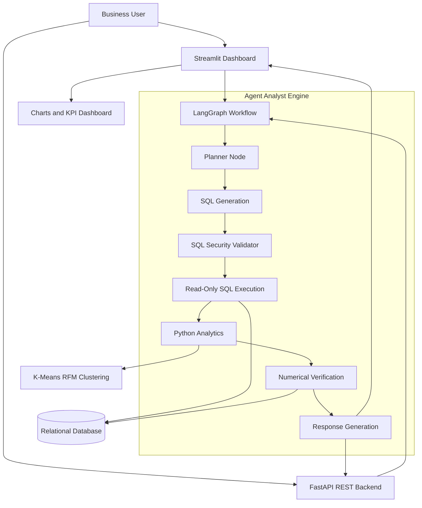
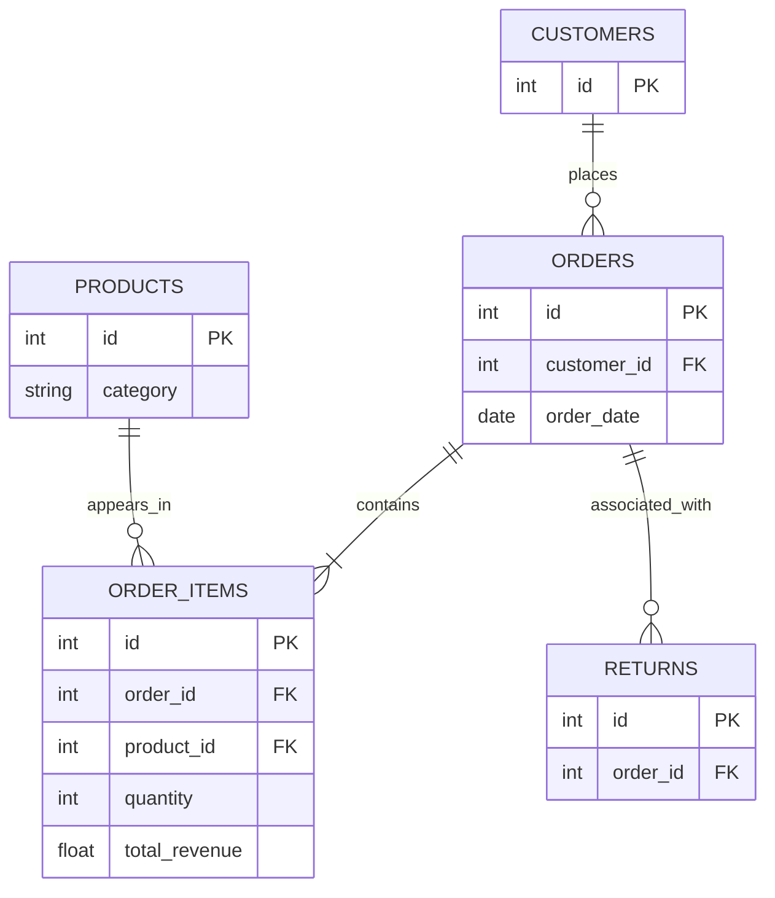

# Agent Analyst — AI-Powered Revenue Intelligence Platform

An intelligent business analytics platform that combines **LangGraph agent orchestration, secure SQL generation, Python-based analytics, numerical verification, and interactive dashboards** to answer business questions using relational data.

Agent Analyst transforms natural-language questions into auditable, data-backed business insights. It features an executive dashboard, an AI analytics copilot, a FastAPI backend, customer segmentation using RFM analysis, and a security-focused SQL validation pipeline.

---

## Table of Contents

- [Project Overview](#project-overview)
- [Benchmark Solution: Revenue Decline Analysis](#benchmark-solution-revenue-decline-analysis)
- [Key Features](#key-features)
- [System Architecture](#system-architecture)
- [Technology Stack](#technology-stack)
- [Repository Structure](#repository-structure)
- [Database Schema](#database-schema)
- [Agent Execution Workflow](#agent-execution-workflow)
- [SQL Security and Numerical Verification](#sql-security-and-numerical-verification)
- [Customer Segmentation](#customer-segmentation)
- [Installation and Setup](#installation-and-setup)
- [Running the Application](#running-the-application)
- [Testing](#testing)
- [API Documentation](#api-documentation)
- [Example Analytical Questions](#example-analytical-questions)
- [Quality Assurance](#quality-assurance)
- [Version Control](#version-control)
- [Future Enhancements](#future-enhancements)

---

## Project Overview

Business teams often need to investigate revenue changes, identify underperforming product categories, understand customer purchasing patterns, and evaluate business performance without manually writing SQL queries.

Agent Analyst addresses this challenge through an AI-driven analytical workflow that converts natural-language questions into structured database queries, validates those queries, computes analytical metrics, and verifies numerical results against database ground truth.

### Primary objectives

- Enable natural-language querying of relational business data.
- Automate multi-step analytical reasoning using LangGraph.
- Generate read-only SQL queries against approved database schemas.
- Calculate revenue changes, growth rates, and contribution metrics using Python.
- Cross-check analytical outputs against database aggregations.
- Present insights through an executive Streamlit dashboard.
- Expose analytical functionality through a FastAPI REST backend.
- Segment customers into actionable groups using K-Means RFM analysis.

### Intended users

- Business analysts
- Data analysts and data scientists
- Sales and revenue operations teams
- Product managers
- Business intelligence teams
- Executives and decision-makers

---

## Benchmark Solution: Revenue Decline Analysis

### Business question

> Which product category contributed most to the revenue decline last quarter?

### Analytical objective

Compare revenue during Q3 2025 and Q4 2025, identify the categories responsible for the change, and quantify each category's contribution to the company's net revenue decline.

**Comparison period:** July–September 2025 versus October–December 2025.

### Agent execution

1. **Planning and decomposition:** The planner identifies the comparison periods, analytical metrics, and required database tables.
2. **SQL generation:** The agent generates a read-only quarterly revenue query using `orders`, `order_items`, and `products`.
3. **Security validation:** The query is checked by the SQL AST/security validation layer against permitted operations and schema rules.
4. **Numerical analysis:** Python computes absolute revenue changes, percentage changes, and contributions to the net deficit.
5. **Ground-truth verification:** The numerical verifier cross-checks calculated outputs against raw database aggregations.
6. **Insight generation:** The agent identifies the leading category behind the revenue decline and summarizes the findings.

### SQL query

The following SQLite-compatible query calculates quarterly category revenue and units sold:

```sql
SELECT
    strftime('%Y', o.order_date) || '-Q' ||
    CAST(
        ((CAST(strftime('%m', o.order_date) AS INTEGER) - 1) / 3) + 1
        AS INTEGER
    ) AS quarter,
    p.category,
    ROUND(SUM(oi.total_revenue), 2) AS revenue,
    SUM(oi.quantity) AS units_sold
FROM order_items AS oi
JOIN orders AS o
    ON oi.order_id = o.id
JOIN products AS p
    ON oi.product_id = p.id
WHERE strftime('%Y', o.order_date) = '2025'
  AND strftime('%m', o.order_date) BETWEEN '07' AND '12'
GROUP BY quarter, p.category
ORDER BY quarter, revenue DESC;
```

This query groups the results by calendar quarter and product category for the second half of 2025.

### Verified benchmark results

The following figures represent the supplied benchmark results and should be reproducible against the corresponding database state.

| Product category | Q3 2025 revenue | Q4 2025 revenue | Revenue change | Change % |
|---|---:|---:|---:|---:|
| Electronics | $250,001.00 | $96,677.00 | -$153,324.00 | -61.3% |
| Apparel | $12,446.50 | $14,095.50 | +$1,649.00 | +13.2% |
| Beauty & Wellness | $16,231.80 | $19,394.81 | +$3,163.01 | +19.5% |
| Home & Kitchen | $31,503.57 | $41,769.51 | +$10,265.94 | +32.6% |
| Sports & Fitness | $23,886.87 | $26,949.67 | +$3,062.80 | +12.8% |
| **Total company** | **$334,069.74** | **$198,886.49** | **-$135,183.25** | **-40.5%** |

### Revenue decline contribution

Contribution to the net deficit is calculated as:

\[
\text{Contribution}_i =
\frac{-\Delta R_i}{|\Delta R_{\text{company}}|}
\times 100
\]

where \(\Delta R_i\) is the category's revenue change and \(\Delta R_{\text{company}}\) is the overall company revenue change.

| Category | Contribution to net deficit |
|---|---:|
| Electronics | 113.4% |
| Apparel | -1.2% |
| Beauty & Wellness | -2.3% |
| Home & Kitchen | -7.6% |
| Sports & Fitness | -2.3% |
| **Net company deficit** | **100.0%** |

Negative contributions represent growth that offsets the decline. Electronics contributes more than 100% because its revenue loss exceeds the net company decline, while the other categories collectively provide a growth buffer.

### Business conclusion

**Electronics was the dominant driver of the Q4 2025 revenue decline.**

- Revenue fell by **$153,324.00**, from $250,001.00 to $96,677.00.
- The category experienced a **61.3% quarter-over-quarter decline**.
- The loss represented approximately **113.4% of the company's net revenue deficit**.
- All four other categories recorded positive revenue growth.
- Total company revenue declined by **$135,183.25**, or approximately 40.5%.

**Recommended next investigation:** Examine electronics sales volume, average selling prices, product availability, returns, and product-level revenue concentration to determine the underlying causes of the decline.

> Note: Numerical verification establishes consistency with the database data used for the calculation. It does not independently establish that the source data is complete or that the inferred business cause is correct.

---

## Key Features

### 1. Natural-language analytics

Ask business questions in plain English without manually writing SQL.

### 2. LangGraph orchestration

A multi-node agent workflow separates planning, query generation, validation, execution, analysis, and response generation.

### 3. Read-only SQL security

A dedicated validation layer checks generated SQL for prohibited operations, unauthorized schema access, and unsafe query patterns.

### 4. Numerical verification

Python calculations are cross-checked against database-level aggregations to identify discrepancies before presenting results.

### 5. Executive dashboard

A Streamlit interface provides business KPIs, interactive revenue visualizations, inventory tables, and an AI question-answering interface.

### 6. REST API

FastAPI provides a backend service layer for analytical requests and integration with other applications.

### 7. Customer intelligence

K-Means clustering and RFM metrics help categorize customers according to purchasing behavior.

### 8. Automated testing

Unit, integration, database, security, and API tests support ongoing development and regression detection.

---

## System Architecture

The platform uses a modular architecture that separates the user interface, agent orchestration, analytical tools, security validation, and database operations.



### Architecture layers

| Layer | Responsibility |
|---|---|
| Presentation | Streamlit dashboard and analytical interaction |
| API | FastAPI endpoints and request handling |
| Orchestration | LangGraph state management and node execution |
| Intelligence | Planning, SQL generation, and response synthesis |
| Security | AST validation, schema restrictions, and read-only access |
| Analytics | Python calculations, statistical analysis, and clustering |
| Verification | Database reconciliation and numerical discrepancy checks |
| Data | SQLAlchemy models and relational database |

---

## Technology Stack

| Technology | Purpose |
|---|---|
| Python | Core application and analytical logic |
| LangGraph | Stateful, multi-step agent orchestration |
| SQLAlchemy | Relational schema and database interaction |
| SQLite or configured SQL database | Business data storage |
| sqlparse and AST validation logic | SQL inspection and security checks |
| Pandas / NumPy | Data manipulation and numerical analysis |
| Scikit-learn | K-Means customer segmentation |
| Plotly | Interactive charts and visualizations |
| Streamlit | Executive dashboard |
| FastAPI | REST backend |
| Pytest | Automated testing |

The exact database driver, language-model provider, and model configuration depend on the project's implementation and `requirements.txt`.

---

## Repository Structure

```text
PROJECT 2/
├── agent/
│   ├── engine.py
│   ├── prompts.py
│   ├── state.py
│   ├── tools.py
│   ├── validator.py
│   ├── verifier.py
│   └── workflow.py
│
├── api/
│   └── app.py
│
├── database/
│   ├── schema.py
│   └── seed_data.py
│
├── ui/
│   └── streamlit_app.py
│
├── tests/
│   ├── test_agent.py
│   ├── test_api.py
│   ├── test_database.py
│   ├── test_validator.py
│   └── test_verifier.py
│
├── requirements.txt
└── README.md
```

### Core modules

| Module | Description |
|---|---|
| `agent/engine.py` | Analytical request handling and query resolution |
| `agent/prompts.py` | Agent instructions and database schema context |
| `agent/state.py` | Typed state shared between LangGraph nodes |
| `agent/tools.py` | SQL execution, Python statistics, Plotly generation, and RFM analysis |
| `agent/validator.py` | SQL inspection and read-only query restrictions |
| `agent/verifier.py` | Numerical reconciliation and discrepancy checks |
| `agent/workflow.py` | LangGraph StateGraph orchestration |
| `api/app.py` | FastAPI application |
| `database/schema.py` | SQLAlchemy database models |
| `database/seed_data.py` | Synthetic business data generation |
| `ui/streamlit_app.py` | Executive dashboard and AI copilot |
| `tests/` | Automated correctness, integration, and security tests |

---

## Database Schema

The relational data model includes customers, products, orders, order items, returns, and marketing spend.

### Core entities

- **Customers:** Customer identifiers and customer-related attributes.
- **Products:** Product identifiers, categories, and product attributes.
- **Orders:** Order identifiers, customer relationships, and order dates.
- **Order items:** Product-level order lines, quantities, and revenue.
- **Returns:** Return records associated with business transactions.
- **Marketing spend:** Marketing expenditure records for performance analysis.

### Revenue analysis relationships



The diagram shows the conceptual relationships required for revenue analysis. Actual field definitions and cardinalities should be confirmed against `database/schema.py`.

### Seed dataset

The provided seed-data specification targets the following dataset:

| Entity | Target records |
|---|---:|
| Customers | 150 |
| Products | 26 |
| Orders | 2,255 |
| Order items | 3,683 |
| Returns | 114 |
| Marketing spend records | 120 |

These counts describe the intended generated dataset; the actual database should be checked after seeding.

---

## Agent Execution Workflow

The LangGraph workflow coordinates the steps required to answer analytical questions.

### Typical execution lifecycle

1. **Request interpretation:** Extract the user's business objective, entities, time periods, and metrics.
2. **Planning:** Determine the query strategy and required tables.
3. **SQL generation:** Generate a query based on the approved schema.
4. **Validation:** Inspect the query for unsafe statements and unauthorized operations.
5. **Execution:** Execute the approved query using the configured database connection.
6. **Analysis:** Calculate deltas, percentages, rankings, and other relevant metrics.
7. **Verification:** Compare analytical calculations with independent database aggregates.
8. **Result synthesis:** Convert verified findings into a clear business explanation.
9. **Final response:** Return the answer with supporting numbers and context.

The implementation's `workflow.py` defines the actual node graph and transitions. The sequence above describes the intended analytical lifecycle; conditional branches and retries depend on the implemented graph.

---

## SQL Security and Numerical Verification

Reliable analytics requires both query safety and result validation.

### Read-only SQL validation

The validator is designed to reject prohibited SQL operations, including:

- `INSERT`
- `UPDATE`
- `DELETE`
- `DROP`
- `ALTER`
- `ATTACH`
- Unsafe stacked statements
- Unauthorized tables or columns

The validation layer should also ensure that only permitted query structures are executed.

**Important security considerations:**

- `sqlparse` is primarily a SQL parsing and formatting library; it is not, by itself, a security-grade AST authorization engine.
- Keyword filtering alone is insufficient to prevent SQL injection or bypasses.
- Use a proper dialect-aware parser or a carefully constrained SQL generation strategy.
- Enforce read-only permissions at the database connection and account level.
- Apply query timeouts, resource limits, and allowlisted table and column access.
- Treat model-generated SQL and all user input as untrusted.

The validator should be tested against adversarial inputs, nested queries, comments, multiple statements, and dialect-specific behavior.

### Numerical verification

The numerical verifier is designed to:

1. Receive calculated analytical metrics.
2. Recompute equivalent values using database-level aggregations.
3. Compare the two results.
4. Identify differences beyond a defined tolerance.
5. Prevent unverified figures from being presented as verified findings.

For the supplied benchmark, the reported numerical discrepancy is **$0.00**.

This is a reported benchmark result, not a guarantee that every possible query will be verified correctly. Verification quality depends on the independence of the calculation paths, aggregation logic, source-data integrity, and test coverage.

---

## Customer Segmentation

The analytics toolkit includes K-Means clustering based on RFM analysis.

RFM stands for:

- **Recency:** How recently a customer made a purchase.
- **Frequency:** How often a customer purchases.
- **Monetary value:** How much a customer spends.

### Intended customer cohorts

| Segment | Business interpretation | Potential action |
|---|---|---|
| Champions | Highly engaged, valuable customers | Loyalty rewards and advocacy |
| Loyal Mid-Tier | Consistent customers with growth potential | Cross-selling and upselling |
| At Risk | Customers showing declining engagement | Targeted win-back campaigns |
| Low Spend | Customers with lower purchase value | Cost-effective engagement strategies |

The project targets four clusters. Cluster labels should be assigned using the observed RFM characteristics of each cluster rather than assuming that K-Means cluster IDs have a fixed business meaning.

Before clustering, numerical features should be appropriately scaled, and the segmentation should be evaluated for stability and business usefulness.

---

## Installation and Setup

### Prerequisites

Install the following before starting:

- Python version compatible with the dependencies in `requirements.txt`
- pip
- Git, if cloning the repository
- Access to the configured language-model provider, if the agent uses an external model

### 1. Obtain the project

If the repository is already available locally, open a terminal in its root directory.

Otherwise, clone the repository:

```bash
git clone <repository-url>
cd "PROJECT 2"
```

Replace `<repository-url>` with the actual repository URL.

### 2. Create a virtual environment

**Windows PowerShell**

```powershell
python -m venv .venv
.\.venv\Scripts\Activate.ps1
```

**macOS / Linux**

```bash
python3 -m venv .venv
source .venv/bin/activate
```

### 3. Install dependencies

```bash
python -m pip install --upgrade pip
pip install -r requirements.txt
```

### 4. Configure environment variables

If the application requires an API key or custom database configuration, define the relevant environment variables before launching it.

For example, in PowerShell:

```powershell
$env:OPENAI_API_KEY = "your-api-key"
```

Use the variable name expected by the actual application. Do not commit API keys, credentials, or other secrets to version control.

### 5. Initialize or reseed the database

Run the seed-data module from the project root:

```bash
python -m database.seed_data
```

This command is intended to generate the project's synthetic business dataset.

**Warning:** Reseeding may replace or recreate existing data, depending on the implementation. Back up any database you need to preserve before running it.

---

## Running the Application

### Launch the Streamlit dashboard

```bash
streamlit run ui/streamlit_app.py
```

Open the local address displayed by Streamlit, typically:

`http://localhost:8501`

The dashboard is designed to provide:

- Executive KPI cards
- Revenue trend visualizations
- Best-selling inventory tables
- Interactive analytical charts
- An AI-powered “Ask AI” copilot

### Launch the FastAPI backend

```bash
uvicorn api.app:app --reload --port 8000
```

Open the interactive API documentation at:

`http://localhost:8000/docs`

The backend's available routes and request schemas are defined by `api/app.py`.

### Run both services

Open two terminal sessions from the project root.

Terminal 1:

```bash
streamlit run ui/streamlit_app.py
```

Terminal 2:

```bash
uvicorn api.app:app --reload --port 8000
```

This allows the dashboard and API backend to run simultaneously, provided their configuration and database access are correctly set up.

---

## Testing

Run the full test suite from the project root:

```bash
python -m pytest
```

For more detailed output:

```bash
python -m pytest -v
```

### Test coverage

| Test module | Testing focus |
|---|---|
| `test_agent.py` | Agent execution and workflow behavior |
| `test_api.py` | API requests, responses, and error handling |
| `test_database.py` | Database integrity and seed-data consistency |
| `test_validator.py` | SQL injection defenses and query restrictions |
| `test_verifier.py` | Numerical calculations and reconciliation |

### Benchmark test status

The supplied project report states that the test suite contains 25 tests and reports the following result:

```text
25 passed in 7.69s
```

This is the reported benchmark status. Run the test suite against the current codebase to independently confirm the result.

### Recommended additional tests

- Malformed and adversarial SQL inputs
- Attempts to access unauthorized tables
- Empty query results and missing values
- Date boundaries and quarter transitions
- Revenue aggregation and rounding differences
- Numerical verifier tolerance behavior
- API validation errors and database failures
- LangGraph retry and failure handling
- Large query results and execution timeouts

---

## API Documentation

The FastAPI application exposes the backend functionality through HTTP endpoints.

Interactive documentation is available at:

`http://localhost:8000/docs`

Use this interface to inspect the implemented endpoints, schemas, request parameters, response structures, and error responses.

The exact route names and payloads should be documented from the actual implementation in `api/app.py` rather than assumed from the architecture.

---

## Example Analytical Questions

Agent Analyst is intended to support questions such as:

### Revenue analytics

- Which product category contributed most to the revenue decline last quarter?
- What was the percentage change in total revenue between two quarters?
- Which products generated the highest revenue this year?
- Which categories showed positive growth despite a decline in overall sales?

### Product performance

- Which products are the best sellers by units sold?
- Which products have experienced the largest revenue decrease?
- How is revenue distributed across product categories?

### Customer intelligence

- Who are the highest-value customers?
- Which customer segments contribute most to revenue?
- Which customers may be at risk of becoming inactive?
- How do purchasing frequency and spending vary between segments?

### Business operations

- How many orders were placed during a selected period?
- What are the trends in product returns?
- How does marketing expenditure compare with sales performance?

The availability and correctness of individual analyses depend on the underlying schema, data quality, supported query logic, and agent implementation.

---

## Quality Assurance

The project is designed around several complementary quality controls.

| Quality dimension | Approach |
|---|---|
| Query safety | SQL inspection and operation restrictions |
| Schema access | Allowlisted tables and columns |
| Numerical correctness | Independent database reconciliation |
| Data integrity | Relational constraints and database tests |
| Workflow reliability | LangGraph execution and agent tests |
| API correctness | FastAPI integration tests |
| Regression prevention | Automated Pytest suite |
| Analytical usefulness | Business-oriented explanations and metrics |

No single validator can guarantee complete security or eliminate all incorrect analytical conclusions. Production deployment should combine application-level validation, least-privilege database access, automated tests, observability, and human review for consequential decisions.

---

## Version Control

The supplied project notes report an initial Git commit:

- **Branch:** `main`
- **Commit:** `3bedecf`

To inspect the repository history:

```bash
git status
git log --oneline
```

To inspect the current branch:

```bash
git branch --show-current
```

These commands verify the actual state of the local repository.

---

## Future Enhancements

Potential next steps for the platform include:

1. **Expanded analytical reasoning:** Support cohort analysis, forecasting, anomaly detection, and profitability metrics.
2. **Improved SQL authorization:** Introduce dialect-aware parsing, query-plan limits, and database-enforced read-only execution.
3. **Richer verification:** Add property-based tests, randomized numerical comparisons, and explicit confidence or discrepancy reporting.
4. **Production observability:** Record query latency, execution failures, model usage, and verification outcomes without logging sensitive data.
5. **Role-based access control:** Restrict analytical access according to user permissions and data sensitivity.
6. **Dashboard exports:** Add downloadable reports and structured business summaries.
7. **Model evaluation:** Build a benchmark suite covering query accuracy, result correctness, security, latency, and cost.
8. **Deployment readiness:** Add containerization, CI/CD, managed database configuration, and health checks.

---

## Conclusion

Agent Analyst demonstrates an end-to-end approach to AI-powered business intelligence by combining natural-language analytics, LangGraph orchestration, controlled SQL execution, Python-based computation, numerical verification, customer segmentation, and executive visualization.

The revenue-decline benchmark illustrates how an analytical agent can transform a business question into a quantified finding: **Electronics accounts for approximately 113.4% of the net revenue deficit, while the other product categories provide a partial growth offset.**

The platform's central design principle is to make analytical outputs more auditable by separating query generation, security validation, computation, and verification.

**Project:** Agent Analyst  
**Category:** AI Agents · Business Intelligence · Data Analytics  
**Core technologies:** Python, LangGraph, SQLAlchemy, FastAPI, Streamlit, Plotly, Scikit-learn, and Pytest
